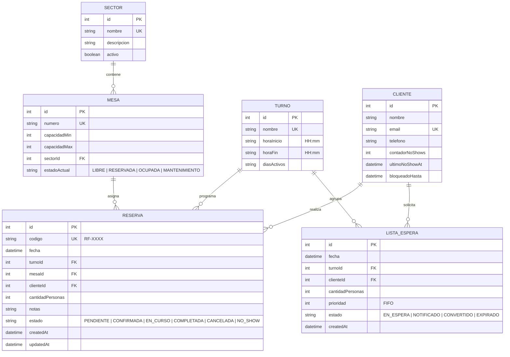
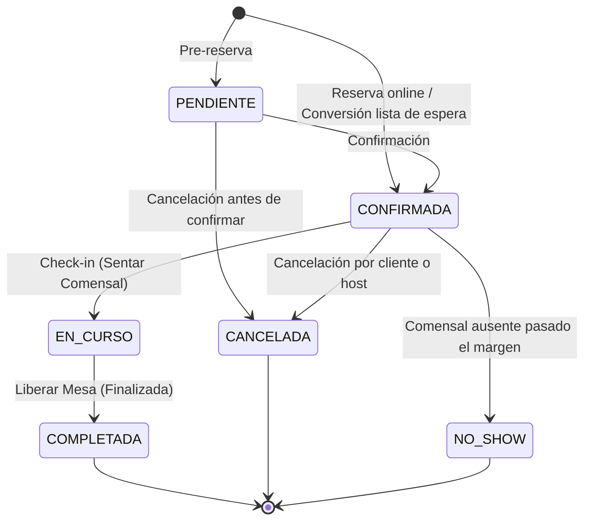

# Especificación Funcional y Técnica — RestoFlow

## 1. Introducción y Alcance

**RestoFlow** es una plataforma full-stack para la gestión operativa de reservas, mesas y lista de espera en establecimientos gastronómicos (restaurantes y bares). Resuelve problemas críticos de operación diaria: solapamiento de reservas sobre una misma mesa (*double booking*), asignación subóptima de capacidad (desperdicio de mesas grandes para grupos pequeños), gestión reactiva de cancelaciones y ausentismo recurrente (*no-shows*).

### Actores del Sistema

| Actor | Responsabilidades y Flujos |
| :--- | :--- |
| **Comensal (Cliente público)** | Consulta disponibilidad en tiempo real por fecha, turno, sector y cantidad de comensales; crea reservas online recibiendo un código único `RF-XXXX`; se registra en la Lista de Espera si el turno está completo; consulta o cancela su reserva mediante código y correo electrónico. |
| **Host / Recepcionista / Encargado** | Opera el Dashboard Operativo por fecha y turno; visualiza el mapa de mesas por sector y KPIs de ocupación; registra el ciclo de vida de la reserva (`Sentar Comensal`, `Liberar Mesa`, `Marcar No-Show`, `Cancelar`); gestiona la Lista de Espera y promueve clientes a reservas confirmadas. |

### Alcance del MVP

- Backend REST API con arquitectura en capas (`routes -> controllers -> services -> repositories`) usando Node.js, Express, TypeScript, Zod y Prisma ORM.
- Base de datos SQLite local con esquema compatible con PostgreSQL (Neon / Supabase) para producción.
- Frontend SPA responsivo y accesible con React, Vite, TypeScript y Tailwind CSS.

---

## 2. Modelo de Dominio



### Descripción de Entidades

1. **Sector (`Sector`)**: Zona física del establecimiento (`Salón Principal`, `Terraza Calefaccionada`, `Barra / VIP`). Incluye bandera `activo` para habilitar o pausar zonas operativas.
2. **Mesa (`Mesa`)**: Unidad física asignable a reservas. Posee un identificador único (`numero`, ej. `M-01`), rango de comensales admitido (`capacidadMin`, `capacidadMax`), pertenencia a `Sector` y un `estadoActual` base (`LIBRE`, `RESERVADA`, `OCUPADA`, `MANTENIMIENTO`). Las mesas en `MANTENIMIENTO` quedan excluidas de la asignación automática.
3. **Turno (`Turno`)**: Ventana horaria de servicio (`Almuerzo`, `Cena 1`, `Cena 2`) con `horaInicio`, `horaFin` y `diasActivos`.
4. **Cliente (`Cliente`)**: Comensal identificado de forma única por `email`. Almacena historial de ausentismo (`contadorNoShows`, `ultimoNoShowAt`) y restricción temporal (`bloqueadoHasta`).
5. **Reserva (`Reserva`)**: Compromiso de mesa para una fecha (`YYYY-MM-DD` normalizado a UTC `00:00:00Z`), turno, mesa y cliente. Se identifica públicamente con un `codigo` único de formato `RF-XXXX`.
6. **ListaEspera (`ListaEspera`)**: Cola ordenada por `prioridad` (entero incremental FIFO por fecha y turno) para comensales que solicitan lugar cuando no hay disponibilidad inmediata.

---

## 3. Máquina de Estados de la Reserva



### Reglas de Transición

- Estados **activos que bloquean una mesa** en `(fecha, turnoId)`: `PENDIENTE`, `CONFIRMADA`, `EN_CURSO`.
- Estados **terminales que liberan la mesa**: `COMPLETADA`, `CANCELADA`, `NO_SHOW`.
- No se permiten transiciones desde un estado terminal hacia otro estado.
- `EN_CURSO` solo puede alcanzarse desde `CONFIRMADA` o `PENDIENTE`.
- `COMPLETADA` solo puede alcanzarse desde `EN_CURSO`.

---

## 4. Matriz de Reglas de Negocio

| ID | Regla | Descripción Técnica | Código de Error / Efecto |
| :--- | :--- | :--- | :--- |
| **RN-01** | **Prevención de Solapamiento (Anti-Double Booking)** | No puede existir más de una reserva en estado activo (`PENDIENTE`, `CONFIRMADA`, `EN_CURSO`) para la misma tupla `(mesaId, fecha, turnoId)`. La validación y creación se ejecutan dentro de una cola de exclusión mutua + transacción atómica `prisma.$transaction`. | `409 Conflict` (`TABLE_ALREADY_BOOKED` o `NO_AVAILABILITY`) |
| **RN-02** | **Capacidad Óptima de Mesa** | Una reserva de $N$ personas solo puede asignarse a una mesa activa (`estadoActual !== 'MANTENIMIENTO'`) donde `capacidadMin <= N <= capacidadMax`. El algoritmo selecciona la mesa libre ordenada por `capacidadMax ASC, capacidadMin ASC, numero ASC` para minimizar desperdicio de plazas. | `409 Conflict` (`NO_AVAILABILITY`) o `422` si se fuerza una mesa incompatible (`INVALID_TABLE_CAPACITY`) |
| **RN-03** | **Política de Protección contra No-Show** | Al marcar una reserva como `NO_SHOW`, se incrementa `contadorNoShows` del cliente. Si el cliente acumula $\ge 2$ reservas `NO_SHOW` dentro de los últimos 30 días, `bloqueadoHasta` se fija automáticamente a `ahora + 30 días`. Todo intento de crear una nueva reserva con ese email mientras `bloqueadoHasta > ahora` es rechazado. | `422 Unprocessable Entity` (`CUSTOMER_BLOCKED`) |
| **RN-04** | **Promoción Automática de Lista de Espera** | Cuando una reserva confirmada o pendiente pasa a `CANCELADA` (o `NO_SHOW`), el servicio busca en `ListaEspera` el primer registro `EN_ESPERA` para la misma `(fecha, turnoId)` ordenado por `prioridad ASC, createdAt ASC` cuya `cantidadPersonas` quepa en la mesa liberada (`capacidadMin <= cantidadPersonas <= capacidadMax`) y actualiza su estado a `NOTIFICADO`. El host puede convertir un registro en `EN_ESPERA` o `NOTIFICADO` a reserva `CONFIRMADA`. | Actualiza `ListaEspera.estado = 'NOTIFICADO'` y devuelve `promotedWaitlist` en la respuesta |
| **RN-05** | **Generador de Código Amigable** | Cada reserva recibe un código único de formato `RF-XXXX` usando el alfabeto sin ambigüedades visuales `ABCDEFGHJKLMNPQRSTUVWXYZ23456789` (excluye `O`, `0`, `I`, `1`), reintentando ante colisión hasta obtener un valor único. | Código único garantizado `RF-[A-Z2-9]{4}` |

---

## 5. Contrato de API REST

Base URL local: `http://localhost:3001/api`

### Formato Estándar de Errores

```json
{
  "error": "Conflict",
  "code": "NO_AVAILABILITY",
  "message": "No hay mesas disponibles para 4 personas en el turno seleccionado.",
  "details": {
    "canJoinWaitlist": true
  }
}
```

| HTTP Status | Significado | Códigos de Negocio |
| :--- | :--- | :--- |
| `400 Bad Request` | Error de validación de esquema (Zod) o parámetros malformados | `VALIDATION_ERROR` |
| `404 Not Found` | Recurso inexistente o combinación código + email inválida | `NOT_FOUND`, `RESERVATION_NOT_FOUND` |
| `409 Conflict` | Conflicto de disponibilidad o transición de estado inválida | `NO_AVAILABILITY`, `TABLE_ALREADY_BOOKED`, `INVALID_STATE_TRANSITION`, `TABLE_IN_MAINTENANCE` |
| `422 Unprocessable Entity` | Regla de dominio violada (cliente bloqueado o capacidad incompatible) | `CUSTOMER_BLOCKED`, `INVALID_TABLE_CAPACITY`, `WAITLIST_ALREADY_CONVERTED` |

---

### 5.1 Catálogo y Disponibilidad

#### `GET /api/health`
Verifica el estado de salud del servicio.
- **200 OK**: `{ "status": "ok", "service": "restoflow-api", "timestamp": "2026-11-15T13:00:00.000Z" }`

#### `GET /api/sectors`
Lista todos los sectores activos del restaurante junto a sus mesas.
- **200 OK**: `{ "sectors": [{ "id": 1, "nombre": "Salón Principal", "descripcion": "...", "activo": true, "tablesCount": 5 }] }`

#### `GET /api/shifts`
Lista todos los turnos configurados.
- **200 OK**: `{ "shifts": [{ "id": 1, "nombre": "Almuerzo", "horaInicio": "12:30", "horaFin": "14:30", "diasActivos": "LUN,MAR,MIE,JUE,VIE,SAB,DOM" }] }`

#### `GET /api/tables?fecha=YYYY-MM-DD&turnoId=1&sectorId=1`
Devuelve todas las mesas con su estado calculado para la fecha y turno indicados, reservas activas asociadas y métricas operativas del turno.
- **Query Params**: `fecha` (opcional, default hoy UTC), `turnoId` (opcional), `sectorId` (opcional).
- **200 OK**:
```json
{
  "fecha": "2026-11-15",
  "turnoId": 2,
  "metrics": {
    "totalTables": 12,
    "activeTables": 11,
    "freeTables": 6,
    "reservedTables": 3,
    "occupiedTables": 2,
    "maintenanceTables": 1,
    "totalCapacity": 48,
    "reservedCovers": 18,
    "freeCovers": 30,
    "occupancyPercentage": 45
  },
  "tables": [
    {
      "id": 1,
      "numero": "M-01",
      "capacidadMin": 1,
      "capacidadMax": 2,
      "sectorId": 1,
      "sectorNombre": "Salón Principal",
      "estadoOperativo": "RESERVADA",
      "estadoBase": "LIBRE",
      "activeReservation": {
        "id": 10,
        "codigo": "RF-7K2P",
        "estado": "CONFIRMADA",
        "cantidadPersonas": 2,
        "clienteNombre": "Camila Soto",
        "clienteEmail": "camila.soto@example.com"
      }
    }
  ]
}
```

#### `GET /api/availability?fecha=YYYY-MM-DD&turnoId=2&cantidadPersonas=2`
Evalúa disponibilidad por sector para una fecha, turno y cantidad de comensales.
- **Query Params**: `fecha` (`YYYY-MM-DD`), `turnoId` (entero positivo), `cantidadPersonas` (entero 1..20).
- **200 OK**:
```json
{
  "fecha": "2026-11-15",
  "turnoId": 2,
  "cantidadPersonas": 2,
  "hasAnyAvailability": true,
  "sectors": [
    {
      "sectorId": 1,
      "nombre": "Salón Principal",
      "descripcion": "Ambiente central con iluminación cálida",
      "availableTablesCount": 2,
      "suggestedTable": {
        "id": 1,
        "numero": "M-01",
        "capacidadMin": 1,
        "capacidadMax": 2
      }
    }
  ]
}
```

---

### 5.2 Reservas

#### `GET /api/reservations?fecha=YYYY-MM-DD&turnoId=2&estado=CONFIRMADA`
Lista reservas filtradas para el Dashboard Operativo.
- **200 OK**: `{ "reservations": [...] }`

#### `GET /api/reservations/lookup?codigo=RF-XXXX&email=cliente@example.com`
Consulta pública de una reserva validando coincidencia de código y correo electrónico (case-insensitive).
- **200 OK**: `{ "reservation": { ... } }`
- **404 Not Found**: `{ "error": "Not Found", "code": "RESERVATION_NOT_FOUND", "message": "No encontramos una reserva con ese código y correo electrónico." }`

#### `POST /api/reservations`
Crea una nueva reserva aplicando RN-01, RN-02, RN-03 y RN-05.
- **Request Body**:
```json
{
  "fecha": "2026-11-16",
  "turnoId": 2,
  "sectorId": 1,
  "cantidadPersonas": 2,
  "nombre": "Martín Vega",
  "email": "martin.vega@example.com",
  "telefono": "+54 9 11 5555-0102",
  "notas": "Mesa tranquila cerca de ventana"
}
```
- **201 Created**:
```json
{
  "message": "Reserva confirmada exitosamente.",
  "reservation": {
    "id": 15,
    "codigo": "RF-8M4Q",
    "fecha": "2026-11-16",
    "estado": "CONFIRMADA",
    "cantidadPersonas": 2,
    "notas": "Mesa tranquila cerca de ventana",
    "turno": { "id": 2, "nombre": "Cena 1", "horaInicio": "20:00", "horaFin": "22:00" },
    "mesa": { "id": 1, "numero": "M-01", "capacidadMin": 1, "capacidadMax": 2, "sectorNombre": "Salón Principal" },
    "cliente": { "id": 11, "nombre": "Martín Vega", "email": "martin.vega@example.com", "telefono": "+54 9 11 5555-0102" }
  }
}
```
- **409 Conflict**: `NO_AVAILABILITY` (sin mesas compatibles libres; incluye `details.canJoinWaitlist = true`).
- **422 Unprocessable Entity**: `CUSTOMER_BLOCKED` (cliente bloqueado por No-Shows).

#### `POST /api/reservations/cancel-by-code`
Permite al comensal cancelar su reserva validando código y email. Dispara promoción automática de Lista de Espera (RN-04).
- **Request Body**:
```json
{
  "codigo": "RF-8M4Q",
  "email": "martin.vega@example.com"
}
```
- **200 OK**: `{ "message": "Reserva cancelada correctamente.", "reservation": { ... }, "promotedWaitlist": null | { ... } }`

#### `PATCH /api/reservations/:id/status`
Actualiza el estado de una reserva desde el Dashboard del Host (`EN_CURSO`, `COMPLETADA`, `CANCELADA`, `NO_SHOW`).
- **Request Body**:
```json
{
  "estado": "EN_CURSO"
}
```
- **200 OK**:
```json
{
  "message": "Estado de reserva actualizado a EN_CURSO.",
  "reservation": { ... },
  "customerBlocked": false,
  "promotedWaitlist": null
}
```
- **409 Conflict**: `INVALID_STATE_TRANSITION` si la máquina de estados prohíbe el cambio.

---

### 5.3 Lista de Espera

#### `GET /api/waitlist?fecha=YYYY-MM-DD&turnoId=2`
Lista las solicitudes en espera ordenadas por `prioridad ASC`.
- **200 OK**: `{ "waitlist": [...] }`

#### `POST /api/waitlist`
Registra un cliente en la cola FIFO de lista de espera para una fecha y turno.
- **Request Body**:
```json
{
  "fecha": "2026-11-16",
  "turnoId": 2,
  "cantidadPersonas": 4,
  "nombre": "Lucía Paredes",
  "email": "lucia.paredes@example.com",
  "telefono": "+54 9 11 5555-0199"
}
```
- **201 Created**: `{ "message": "Te anotamos en la lista de espera.", "entry": { "id": 4, "prioridad": 2, "estado": "EN_ESPERA", ... } }`
- **422 Unprocessable Entity**: `CUSTOMER_BLOCKED` si el cliente está bloqueado por no-shows.

#### `POST /api/waitlist/:id/convert`
Promueve un registro de lista de espera (`EN_ESPERA` o `NOTIFICADO`) creando una reserva `CONFIRMADA` en una mesa disponible compatible y marcando la entrada como `CONVERTIDO`.
- **Request Body** (opcional): `{ "sectorId": 1, "mesaId": 3, "notas": "Convertido desde lista de espera" }`
- **200 OK**: `{ "message": "Cliente promovido a reserva confirmada.", "entry": { ... }, "reservation": { ... } }`
- **409 Conflict**: `NO_AVAILABILITY` si sigue sin haber mesa disponible compatible.
